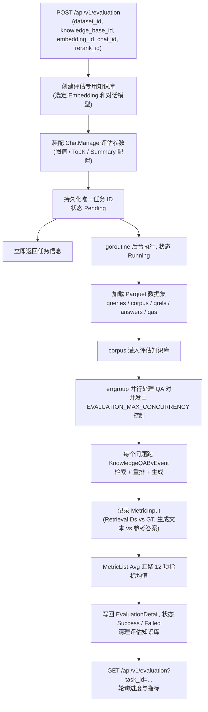

# 评估能力（Evaluation）

评估使用带标准答案的问答数据集，比较分块、模型和检索配置的效果。系统创建评估知识库并导入语料，逐题执行检索与生成，输出 Precision、Recall、NDCG、MRR、MAP、BLEU 和 ROUGE 等指标。

::: tip 界面与 API
空间管理员可在「设置 → RAG Evaluation」发起评估并比较同一数据集的历史运行。也可通过 `POST /api/v1/evaluation` 发起、`GET /api/v1/evaluation?task_id=...` 轮询结果；不带 `task_id` 的 GET 返回当前空间最近 20 次运行。创建和读取均需要 Admin 权限，因为逐题结果包含脱敏题目与生成答案。数据集由部署管理员以只读文件挂载，页面不会上传语料。
:::

比较配置时应固定数据集，每次调整一个变量，并对照同一组指标分析结果。

## 运行一次评估

1. 准备符合下方格式、已脱敏且获准用于所选模型的 Parquet 数据集，或使用内置 `default` 样本。自定义数据集挂载于 `EVALUATION_DATASET_DIR/<dataset_id>/`；`dataset_id` 只允许字母、数字、下划线和短横线。默认每次最多 100 题，可由部署管理员设置 `EVALUATION_MAX_QUESTIONS`（1–10000）；这只是单次调用量上限，不是货币费用预算。
2. 明确选择 Embedding、对话模型和重排模型，通过 `POST /api/v1/evaluation` 创建任务。评估使用单独的临时知识库。指定参考知识库时，临时库沿用其 Embedding 模型，显式提供的 `embedding_id` 须与其一致。
3. 记录返回的任务 ID，通过 `GET /api/v1/evaluation?task_id=...` 查询状态和进度。
4. 任务成功后比较检索与生成指标；失败时先检查任务错误，再调整配置并重新运行。

创建与查询任务均需要 Admin 权限；API Key 还需 `run_evaluations` 能力或 full-access。

## 数据集格式

数据集服务（`internal/application/service/dataset.go`）为 `default` 从 `EVALUATION_DEFAULT_DATASET_DIR`（未设置时 `./dataset/samples/`）加载；自定义 ID 从环境变量 `EVALUATION_DATASET_DIR` 指向的目录（未设置时为 `./dataset/benchmarks/`）下加载同名子目录中的 5 个 **Parquet** 文件：

| 文件 | Schema | 含义 |
| --- | --- | --- |
| `queries.parquet` | `id: int64, text: string` | 问题集合 |
| `corpus.parquet` | `id: int64, text: string` | 语料段落（评估时灌入知识库） |
| `answers.parquet` | `id: int64, text: string` | 参考答案 |
| `qrels.parquet` | `qid: int64, pid: int64` | 问题 → 相关段落的 ground truth 关联（检索指标依据） |
| `qas.parquet` | `qid: int64, aid: int64` | 问题 → 答案映射（生成指标依据） |

对应的 Go 结构体：

```go
type TextInfo struct {
    ID   int64  `parquet:"id"`
    Text string `parquet:"text"`
}
type RelsInfo struct {
    QID int64 `parquet:"qid"`
    PID int64 `parquet:"pid"`
}
type QaInfo struct {
    QID int64 `parquet:"qid"`
    AID int64 `parquet:"aid"`
}
```

加载后拼装为逐样本的 `QAPair`（`internal/types/dataset.go`）：

```go
type QAPair struct {
    QID      int      // 问题 ID
    Question string   // 问题文本
    PIDs     []int    // 相关段落 ID（ground truth）
    Passages []string // 段落文本
    AID      int      // 答案 ID
    Answer   string   // 参考答案文本
}
```

自定义数据集需按上述 Schema 生成同名 Parquet 文件，由部署人员以只读目录挂载。完整语料都会被索引，包括没有关联 qrel 的干扰段落；稀疏 passage ID 会映射为稳定的连续 ID，避免大 ID 导致内存耗尽。无关联 passage 的问题不计入检索指标均值；无参考答案的问题不计入生成指标均值。服务只记录题数与段落数，不把问题原文写入评估日志。

## 结果查询

`GET /api/v1/evaluation?task_id=<返回的任务 ID>`，返回 `EvaluationDetail`：

```json
{
  "success": true,
  "data": {
    "task": {
      "id": "evaluation_1_1758600000000_1a2b3c4d_default",
      "dataset_id": "default",
      "status": 2,
      "total": 100,
      "finished": 100
    },
    "params": { "...": "ChatManage 评估参数快照" },
    "metric": {
      "metric_version": 3,
      "retrieval_metrics": {
        "precision": 0.85, "recall": 0.92,
        "ndcg3": 0.88, "ndcg10": 0.86,
        "mrr": 0.95, "map": 0.87
      },
      "generation_metrics": {
        "bleu1": 0.72, "bleu2": 0.65, "bleu4": 0.58,
        "rouge1": 0.78, "rouge2": 0.71, "rougel": 0.75
      }
    }
  }
}
```

任务运行期间可轮询该接口获取 `finished / total` 进度；`status = 3` 时 `err_msg` 携带失败原因。

> **注意**：运行记录、参数、进度和指标现在写入 `evaluation_runs` 表，服务重启后可查询历史结果。正在运行的任务不具备跨进程续跑能力；若运行实例重启，应将旧任务视为中断并重新发起。每次运行记录数据集 SHA-256、模型 ID 与 `WEKNORA_BUILD_COMMIT`（若部署设置），便于判断两次结果是否可比。页面仅比较数据集指纹、指标版本和并发数均相同的两次成功运行。历史记录保留原分数，缺少 `metric_version` 的记录按 v1 比较。

> **真实基线门槛**：模拟 Embedding、缺失 ReRank 或仅有对话模型时，不应称为真实 RAG 效果验证。评估需使用获准处理该数据集的正式模型；页面会拒绝显式的模拟/低维 Embedding。权限类问题还须按不同 AD 身份分别运行端到端授权测试；此离线评估会创建临时知识库，不能替代真实权限测试。

## 指标清单

指标注册表见 `internal/application/service/metric_hook.go`，共 12 项，分两组。文本先经 `metric/common.go` 分词：中文用 Jieba 分词、英文按空白切分、按 `。` / `.` 切句。

### 检索指标（Retrieval Metrics）

| 指标 | 字段 | 实现文件 | 含义 |
| --- | --- | --- | --- |
| Precision | `precision` | `metric/precision.go` | 检索准确率：命中的相关文档数 / 检索返回总数，按 GT 集合求均值 |
| Recall | `recall` | `metric/recall.go` | 检索召回率：命中的相关文档数 / 相关文档总数 |
| NDCG@3 | `ndcg3` | `metric/ndcg.go` | 归一化折损累计增益（取前 3 位），奖励把相关文档排在前面 |
| NDCG@10 | `ndcg10` | `metric/ndcg.go` | 同上，取前 10 位 |
| MRR | `mrr` | `metric/mrr.go` | 首个相关文档倒数排名的平均：`sum(1/rank) / N` |
| MAP | `map` | `metric/map.go` | 平均精度均值：对每个命中位置累计 `Precision@k` 再归一化 |

NDCG 核心计算（`metric/ndcg.go`）：

理想排序使用去重后的全部相关文档，最多取前 k 个，不受实际召回数量限制。v0.9.0 修正了少量召回时分母偏小的问题，新评估记录使用指标版本 v3。例如，3 个相关文档只召回 1 个且排在首位时，v2 的 NDCG@10 为 1，v3 约为 0.469。要在 v3 下比较配置，需要重新运行基线评估。

```go
// DCG = sum((2^rel_i - 1) / log2(i+2))，rel 为 0/1
dcg += (math.Pow(2, float64(relevance)) - 1) / math.Log2(float64(i+2))
// NDCG = DCG / IDCG（理想排序的 DCG）
```

MRR 核心计算（`metric/mrr.go`）：

```go
for i, predID := range ids {
    if _, ok := gtSet[predID]; ok {
        sumRR += 1.0 / float64(i+1) // 第一个命中位置的倒数
        break
    }
}
```

### 生成指标（Generation Metrics）

| 指标 | 字段 | 实现文件 | 含义 |
| --- | --- | --- | --- |
| BLEU-1 | `bleu1` | `metric/bleu.go` | 1-gram 精度（权重 `[1.0, 0, 0, 0]`） |
| BLEU-2 | `bleu2` | `metric/bleu.go` | 1/2-gram 各 50%（权重 `[0.5, 0.5, 0, 0]`） |
| BLEU-4 | `bleu4` | `metric/bleu.go` | 1~4-gram 均权（`[0.25, 0.25, 0.25, 0.25]`），含 brevity penalty |
| ROUGE-1 | `rouge1` | `metric/rouge.go` | 一元词重叠 F1 |
| ROUGE-2 | `rouge2` | `metric/rouge.go` | 二元词组重叠 F1 |
| ROUGE-L | `rougel` | `metric/rouge.go` | 最长公共子序列（LCS）F1 |

BLEU 核心（`metric/bleu.go`）：修正 n-gram 精度的加权几何平均乘以简短惩罚 `bp * exp(sum(w_i * log(p_i)))`。ROUGE 取 F1：`F1 = 2PR / (P + R + 1e-8)`（`metric/rouge_score.go`）。

未开启平滑时，任何权重大于零的 n-gram 精度为零，BLEU 都应为零。v0.9.0 修正了跳过这些零精度项导致分数偏高的问题。

## 接口与执行参考

### API

`internal/router/routes_infra.go` 的 `RegisterEvaluationRoutes`：

```go
evaluationRoutes := g.apiKeyGroup(r.Group("/evaluation"), apiKeyRunEvaluations(apiKeyFullAccess()))
{
    evaluationRoutes.POST("", g.Admin(), handler.Evaluation)
    evaluationRoutes.GET("", g.Admin(), handler.GetEvaluationResult)
}
```

| 方法 | 路径 | 权限 | 说明 |
| --- | --- | --- | --- |
| POST | `/api/v1/evaluation` | Admin（API Key 需 `run_evaluations` 能力或 full-access） | 创建评估任务，立即返回任务信息 |
| GET | `/api/v1/evaluation?task_id=...` | Admin（API Key 需 `run_evaluations` 能力或 full-access） | 查询任务状态、进度与指标结果；不带任务 ID 时查询当前空间历史 |

#### 创建评估任务

请求参数（`internal/handler/evaluation.go`）：

```go
type EvaluationRequest struct {
    DatasetID        string `json:"dataset_id"`        // 数据集 ID，默认 "default"
    KnowledgeBaseID  string `json:"knowledge_base_id"` // 参考知识库（沿用其 Embedding 模型）
    ChatModelID      string `json:"chat_id"`           // 聊天模型
    RerankModelID    string `json:"rerank_id"`         // 重排模型
    EmbeddingModelID string `json:"embedding_id"`     // 评估知识库使用的 Embedding
}
```

| 参数 | 必填 | 默认行为 |
| --- | --- | --- |
| `dataset_id` | 否 | 缺省使用内置 `default` 样本；自定义 ID 选择同名的已挂载数据集 |
| `knowledge_base_id` | 否 | 提供时在独立评估库中沿用参考库的 Embedding 模型 |
| `embedding_id` | 自定义题集必填 | 内置默认样本保留自动选择；提供参考库时必须与其 Embedding 一致 |
| `chat_id` | 自定义题集必填 | 内置默认样本保留自动选择；选定模型同时用于临时入库摘要与最终答复 |
| `rerank_id` | 自定义题集必填 | 内置默认样本保留使用默认 ReRank 模型；没有可用模型时跳过重排 |

自定义题集（`dataset_id` 非内置 `default`），以及通过 `EVALUATION_DEFAULT_DATASET_DIR` 替换默认样本的运行，必须显式指定以上三个模型 ID；缺一返回 400。显式选择只能防止模型隐式替换，不代表数据负责人已批准该模型或外发范围。

每次运行生成带毫秒时间戳和随机串的任务 ID，请使用创建响应中的 ID 查询。任务对象（`internal/types/evaluation.go`）：

```go
type EvaluationTask struct {
    ID        string           `json:"id"`
    TenantID  uint64           `json:"tenant_id"`
    DatasetID string           `json:"dataset_id"`
    StartTime time.Time        `json:"start_time"`
    Status    EvaluationStatue `json:"status"`
    ErrMsg    string           `json:"err_msg,omitempty"`
    Total     int              `json:"total,omitempty"`    // 样本总数
    Finished  int              `json:"finished,omitempty"` // 已完成数
}
```

请求可增加 `embedding_id` 指定评估知识库的 Embedding。结果附有 `dataset_sha256`、`embedding_model_id`、`chat_model_id`、`rerank_model_id`、`build_revision`，以及 P50/P95 延迟和对话 token 用量。金额成本需要配置并版本化模型计价后另行计算，不能把 token 数当作费用。

BLEU/ROUGE 衡量文本重叠，**不代表**答案忠于检索证据，也不代表引用准确。建议基于脱敏问题、检索上下文和答案，使用 [Ragas](https://arxiv.org/abs/2309.15217) 的证据忠实度思路，并用 [ARES](https://arxiv.org/abs/2311.09476) 所强调的少量人工标注校准自动评审。当前界面明确将这两项标为尚未自动评分，不会伪造合格结论。

任务状态枚举（注意源码中拼写为 `EvaluationStatue`）：

```go
const (
    EvaluationStatuePending EvaluationStatue = iota // 0 待启动
    EvaluationStatueRunning                          // 1 运行中
    EvaluationStatueSuccess                          // 2 成功
    EvaluationStatueFailed                           // 3 失败
)
```

### 评估流程

`internal/application/service/evaluation.go` 中，POST 接口**同步完成准备、异步执行评估**：

1. **知识库准备**：创建独立评估库，使用选择的 Embedding（提供参考库时须与参考库一致）和对话模型；
2. **参数装配**：从系统配置装配 `ChatManage` 评估参数——`VectorThreshold`、`KeywordThreshold`、`EmbeddingTopK`、`RerankTopK`、`RerankThreshold`、`MaxRounds`、`SummaryConfig`（MaxTokens / TopK / TopP / RepeatPenalty / Prompt / ContextTemplate 等）、`FallbackResponse`、改写提示词等；
3. **任务注册**：以唯一任务 ID 写入数据库，状态 `Pending`，立即返回响应；
4. **后台执行**（goroutine）：将数据集 corpus 灌入评估 KB → 并行评估每个 QA 对 → 汇聚指标 → 清理资源。

并发度由 `EVALUATION_MAX_CONCURRENCY` 控制，默认 2，允许 1–64：

```go
var g errgroup.Group
g.SetLimit(workers)
for i, qaPair := range dataset {
    g.Go(func() error {
        // 1. 克隆 ChatManage 配置
        // 2. 走 KnowledgeQAByEvent 完整管道（检索 + 重排 + 生成）
        // 3. 记录 MetricInput（检索到的 passage ID、生成文本、GT）
        // 4. 加锁更新 finished 进度
    })
}
g.Wait()
```

每个样本产出一个 `MetricInput`（`internal/types/evaluation.go`）：

```go
type MetricInput struct {
    RetrievalGT    [][]int // 检索 ground truth（相关 passage ID 列表）
    RetrievalIDs   []int   // 实际检索返回的 passage ID
    GeneratedTexts string  // 模型生成文本
    GeneratedGT    string  // 参考答案
}
```

`metric_hook.go` 按每道题可用的检索和生成标签计算指标，最终 `Avg()` 对各组已评分样本取均值，写入 `MetricResult`。

::: warning RetrievalIDs 的口径
入库时会把全部 passage 的 ID 映射为连续序号，再用 `CreateKnowledgeFromPassageSync` 等待语料索引完成。评估时用临时文档 ID 和文本分块的 `ChunkIndex` 还原检索到的 passage。未知或属于其他文档的命中计为不相关；重排结果为空时使用原始检索结果。
:::

#### 评估流程图



## 实现参考

以下路径均相对仓库根目录：

| 层 | 文件 |
| --- | --- |
| HTTP Handler | `internal/handler/evaluation.go` |
| 评估服务 | `internal/application/service/evaluation.go` |
| 指标注册与汇聚 | `internal/application/service/metric_hook.go` |
| 指标实现 | `internal/application/service/metric/`（`precision.go`、`recall.go`、`ndcg.go`、`mrr.go`、`map.go`、`bleu.go`、`rouge.go`、`rouge_score.go`、`common.go`） |
| 数据集加载 | `internal/application/service/dataset.go` |
| 类型定义 | `internal/types/evaluation.go`、`internal/types/dataset.go` |
| 内置样例数据集 | `dataset/samples/`（Parquet 文件） |
| 路由注册 | `internal/router/routes_infra.go` 的 `RegisterEvaluationRoutes` |
